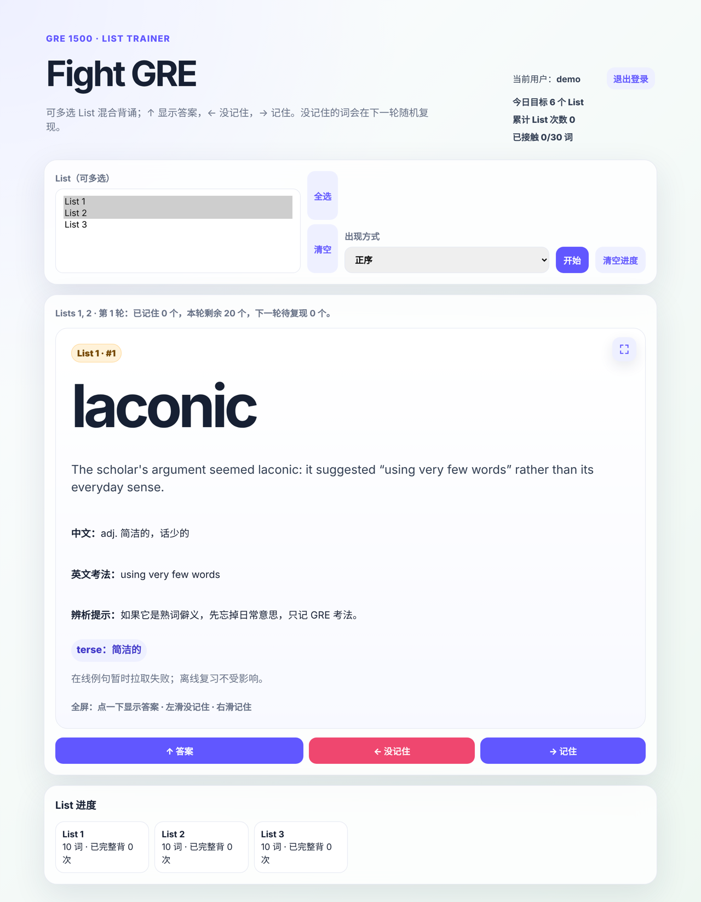

# GRE List Trainer

A Django web app for memorising GRE vocabulary list by list, with per-user accounts and server-side progress tracking. It has been running in production since August 2026 and is used by a small group of paying learners.



## Features

- **Accounts**: username/password registration and login; every API call is scoped to `request.user`, so progress is fully isolated between users (covered by tests).
- **Study modes**: pick one or several lists, study them in order, shuffled, or grouped by near-synonyms.
- **Spaced repetition loop**: ↑ reveal, ← "missed", → "got it". Missed words reappear at random in the next round, and a list counts as completed once every word in it is marked "got it".
- **Progress sync**: word-level state (seen / correct / wrong / ease / due) and list completion counts are stored in the database through a small JSON API, with `localStorage` as an offline fallback.
- **Mobile friendly**: full-screen card with tap to reveal and swipe left/right to grade.
- **Online examples**: fetches example sentences from the Free Dictionary API when available; external text is rendered with `textContent` only, never `innerHTML`.

## Tech stack

Python · Django 5 · SQLite · vanilla JavaScript · CSS · deployed behind Nginx with HTTPS

## API

All endpoints need an authenticated session.

| Method | Endpoint | Purpose |
|---|---|---|
| `GET` / `DELETE` | `/api/progress/` | Get or reset the current user's word progress |
| `PUT` | `/api/progress/<word_id>/` | Upsert one word's state |
| `GET` / `DELETE` | `/api/lists/` | Get or reset list completion counts |
| `POST` | `/api/lists/<list_no>/complete/` | Increment a list's completion count |

## Run locally

```bash
python3 -m venv .venv
.venv/bin/pip install -r requirements.txt
.venv/bin/python manage.py migrate
.venv/bin/python manage.py runserver
```

Open <http://127.0.0.1:8000/> and register an account.

```bash
.venv/bin/python manage.py test vocab   # 10 tests: auth, open-redirect guard, per-user isolation, orphan-row handling
```

Progress saved before accounts existed has no owner. An admin can assign it explicitly with `python manage.py claim_orphan_progress <username>`; registration never claims it automatically.

For production set the variables in [`.env.example`](.env.example). The app refuses to start with `DJANGO_DEBUG=0` and no `DJANGO_SECRET_KEY`.

## Word data

The repository ships a **30-word sample** (`vocab/static/vocab/data/words.json`) with original definitions so the app runs out of the box. The production word list is not included. To use your own list, replace `words.json` and `words.js` with entries of the form:

```json
{"list": 1, "index": 1, "word": "laconic", "cn": "adj. 简洁的", "en": "using very few words", "id": "L01-01-laconic"}
```

## License

MIT. See [LICENSE](LICENSE).
